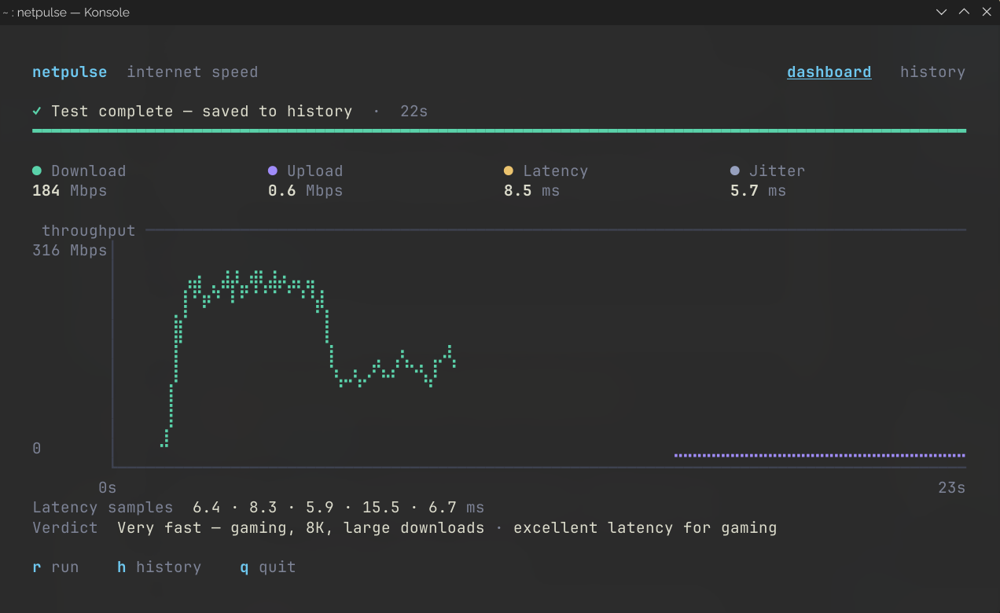

# NetPulse

A terminal-based internet speed test written in Rust. NetPulse measures download speed, upload speed, latency, and jitter, visualizes a live test in the terminal, and keeps a local history of past results in SQLite.



## Features

- Live download, upload, latency, and jitter measurements.
- Animated dashboard with metric cards, a packet-flow view, and a live throughput chart.
- Latency samples and a plain-language verdict after each test.
- Tests run on a background thread, so the UI stays responsive.
- Results are saved to a local SQLite database.
- Recent history view with per-record download bars.

## Tech Stack

| Technology | Purpose |
|---|---|
| Rust | Application logic and measurements |
| Ratatui | Terminal UI and charts |
| Crossterm | Terminal control and key input |
| Reqwest | HTTP requests for speed tests |
| rusqlite | SQLite persistence |

## Requirements

- A recent stable Rust toolchain (the project uses the 2024 edition).
- A C compiler for the bundled SQLite build (`build-essential` on Debian/Ubuntu, Xcode Command Line Tools on macOS).
- On Windows, Visual Studio Build Tools with the **Desktop development with C++** workload, which provides the `link.exe` linker. The included `install.ps1` can install this for you.
- An active internet connection (the speed tests use public Cloudflare endpoints).

## Getting Started

### 1. Install Rust

Install the stable Rust toolchain with [rustup](https://rustup.rs/):

- **Windows:** download and run `rustup-init.exe` from <https://rustup.rs/>.
- **macOS / Linux:** run `curl --proto '=https' --tlsv1.2 -sSf https://sh.rustup.rs | sh`.

Restart the terminal after installing so `cargo` is on your `PATH`, then verify:

```bash
cargo --version
```

> **Windows:** Rust uses Microsoft's `link.exe` linker, so a missing Visual Studio Build Tools installation causes `error: linker 'link.exe' not found`. The `install.ps1` script below installs the Build Tools automatically.

### 2. Clone and build

```bash
git clone https://github.com/aakash-rajbhar/netpulse.git
cd netpulse
cargo build --release
```

The binary is written to `target/release/netpulse` (`netpulse.exe` on Windows).

### 3. Make the `netpulse` command available

To run `netpulse` from any directory, install the binary with Cargo:

```bash
cargo install --path .
```

Cargo installs it into `~/.cargo/bin` (`%USERPROFILE%\.cargo\bin` on Windows), which rustup adds to your `PATH`. Open a new terminal and confirm it is found:

```bash
# macOS / Linux
command -v netpulse

# Windows PowerShell
Get-Command netpulse
```

If you prefer not to install it, run the binary directly from the project directory using the OS-specific commands below.

#### Windows one-command install

From the project directory in PowerShell:

```powershell
powershell -ExecutionPolicy Bypass -File .\install.ps1
```

The script checks for `cargo`, installs the Microsoft C++ Build Tools if `link.exe` is unavailable (via `winget`), configures the MSVC environment, and runs `cargo install --path . --locked`. Open a new terminal afterwards and run:

```powershell
netpulse
```

If the Build Tools are already installed, plain `cargo install --path . --locked` is enough.

## Run NetPulse by Operating System

Launch NetPulse in a terminal that supports 256 colors. The app takes over the screen and restores it when you quit.

### Windows

Use **Windows Terminal**, **PowerShell**, or **Command Prompt**.

```powershell
# From the project directory, without installing
.\target\release\netpulse.exe

# Or, if installed with `cargo install --path .`
netpulse
```

If PowerShell blocks the command with an execution-policy or path error, run it with an explicit path, e.g. `& ".\target\release\netpulse.exe"`.

### macOS

```bash
# From the project directory, without installing
./target/release/netpulse

# Or, if installed with `cargo install --path .`
netpulse
```

If macOS warns that the binary cannot be opened, allow it under **System Settings → Privacy & Security**, or run `xattr -d com.apple.quarantine ./target/release/netpulse`.

### Linux

```bash
# From the project directory, without installing
./target/release/netpulse

# Or, if installed with `cargo install --path .`
netpulse
```

If the binary is not executable, run `chmod +x ./target/release/netpulse` first.

> **WSL:** run NetPulse inside the Linux distribution (not from Windows `cmd.exe`) so the terminal escape sequences render correctly.

## Troubleshooting

### `error: linker 'link.exe' not found` (Windows)

Rust's MSVC toolchain needs the Microsoft linker. Run `.\install.ps1`, or install [Visual Studio Build Tools](https://visualstudio.microsoft.com/visual-cpp-build-tools/) with the **Desktop development with C++** workload, then reopen the terminal and run:

```powershell
cargo install --path . --locked
```

### `netpulse` is not recognized

Open a new terminal so the updated `PATH` is loaded. If it still is not found, add `%USERPROFILE%\.cargo\bin` to your user `PATH`, or run the binary directly as `.\target\release\netpulse.exe`.

## Running a Speed Test

1. Open a terminal on your OS.
2. Start NetPulse with `netpulse` (or the direct binary path shown above).
3. Press `R` to start a test. The status bar shows the current phase: latency, download, then upload.
4. Watch the metric cards and live throughput chart update as the test runs.
5. Press `H` to review recent results, then `H` again to return to the dashboard.
6. Press `Q` or `Esc` to quit. The completed result is saved to `netpulse.db` automatically.

## Usage

| Key | Action |
|---|---|
| `R` | Start a new speed test (ignored while a test is running) |
| `H` | Toggle between the dashboard and history views |
| `Q` or `Esc` | Quit |

A test runs in three phases:

1. **Latency** — five HTTP requests, 250 ms apart.
2. **Download** — repeated 10 MB requests for up to 8 seconds.
3. **Upload** — 512 KiB chunks for up to 8 seconds (128 MiB cap).

When the test finishes, the result is saved even if one or more metrics failed.

## How Measurements Work

### Latency

Each sample is the time to complete a GET request to `https://www.google.com/generate_204`. The reported latency is the mean of all successful samples.

### Jitter

Jitter is the average absolute difference between consecutive successful latency samples. For samples `L1 … Ln`:

```text
jitter = Σ |L(i+1) − L(i)| / (n − 1)
```

Jitter requires at least two successful samples.

### Download

NetPulse repeatedly requests 10 MB from `https://speed.cloudflare.com/__down?bytes=10000000` and streams the response, stopping when the 8-second deadline is reached. Throughput is:

```text
Mbps = total_bytes × 8 / elapsed_seconds / 1,000,000
```

Live samples are emitted roughly every 100 ms and smoothed for display.

### Upload

NetPulse posts 512 KiB chunks to `https://speed.cloudflare.com/__up` until the 8-second deadline or a 128 MiB cap is reached. A partial upload still produces a result. If the first attempt fails, it retries once over HTTP/1.1, since some networks and proxies stall HTTP/2 uploads.

## Data Storage

NetPulse creates `netpulse.db` in the working directory on first run. The `test_history` table stores:

| Column | Type |
|---|---|
| `id` | INTEGER PRIMARY KEY |
| `tested_at` | TEXT (local time) |
| `download_mbps` | REAL, nullable |
| `upload_mbps` | REAL, nullable |
| `latency_ms` | REAL, nullable |
| `jitter_ms` | REAL, nullable |

Failed metrics are stored as `NULL`. The history view shows the latest 10 records; older records are retained.

## Project Structure

```text
netpulse/
├── Cargo.toml
├── Cargo.lock
├── src/
│   └── main.rs
└── netpulse.db   # created on first run
```

## Limitations

- Latency uses HTTP response time, not ICMP ping.
- Download and upload figures are application-level estimates, not a connection's theoretical maximum.
- Results vary with network congestion, server load, and connection conditions.
- Tests depend on Cloudflare and Google endpoints being reachable.

## License

MIT
